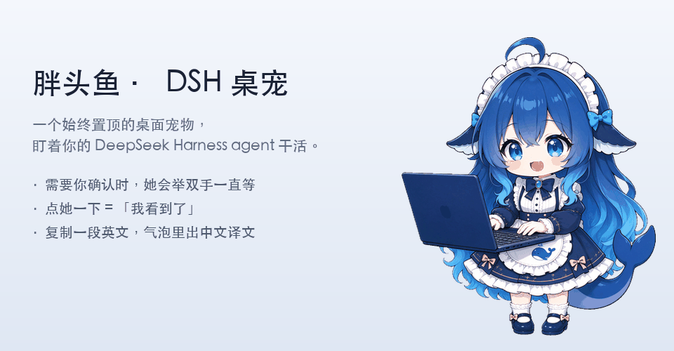
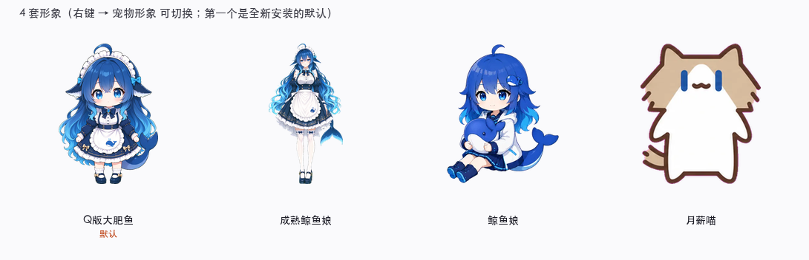
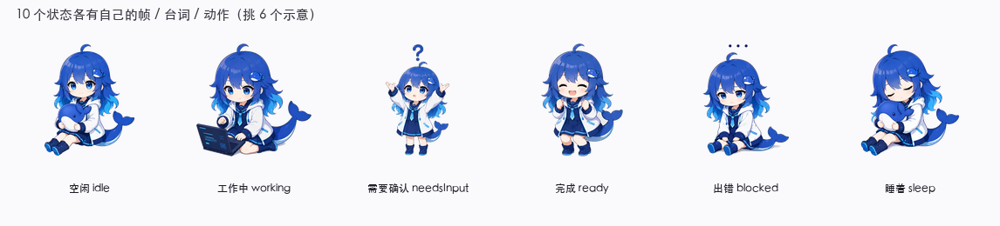

# 胖头鱼 · DSH 桌宠



> 上面是**真的在动**（GitHub 上会自动播放）—— **Q版大肥鱼**，默认形象。

**一个会因为你太久不理她而生气的桌宠。**

她替你盯着 [DeepSeek Harness](https://github.com/deepseek-ai) agent 干活 ——
**用情绪**把状态告诉你，而不是弹一个通知：

> agent 跑起来的时候她敲键盘。
> 要你确认的时候她**举起手，一直举着**。
>
> 举到 30 秒她说「看这里看这里！」
> 举到 2 分钟她说「我等得花都谢了」
> 举到 5 分钟她说「**我举着手好累的**」
> 举到 10 分钟她……**默默放下手，然后睡着了**。

> ⚠️ **非官方项目。** 和 DeepSeek 官方没有任何关系，也没有得到官方背书。
> 详见下面的[免责声明](#免责声明)。

---

## 她不一样的地方

### ① 她的台词是一份**剧本**，不是一份消息列表

不是"工作完成了 → 从数组里随机挑一句"。
是**按你晾了她多久推进**的 —— 从试探，到不耐烦，到放弃：

**「需要你确认」这条线：**

| 晾了多久 | 她说 |
| --- | --- |
| 立刻 | 这里需要你确认一下！／卡住了，等你决定 |
| **30 秒** | 还在等你哦～／**看这里看这里！** |
| **2 分钟** | 喂——你还在吗？／**我等得花都谢了** |
| **5 分钟** | 你是不是把我忘了……／**我举着手好累的** |
| **10 分钟** | ……（**默默放下手**）／算了，我先睡一会儿 |

**「出错」这条线更狠：**

| 晾了多久 | 她说 |
| --- | --- |
| 立刻 | 出错了……／这一步卡住了 |
| **30 秒** | 卡在这儿了，你看看？／**报错了，我不敢往下走** |
| **2 分钟** | 还卡着呢……／要不要重新试一次？ |
| **5 分钟** | （**蹲在角落里**）／**我是不是做错了什么……** |
| **10 分钟** | ……／（**已经不指望了**） |

—— 而且「需要确认」和「出错」的**气泡是常驻的，不会自己消失**。
她一直举着手等你，等到你看见为止。

### ② ⭐ 她的剧本是**纯 Markdown**，换个性格就是换个人设

**71 条台词，全在一个文件里。** 没有编译、没有 JSON、没有第二份副本 ——
运行时直接解析你改的那一份。

```markdown
## needsInput [fixed]  ← 需要人工确认 —— 她在等你
- #1 这里需要你确认一下！
- #2 有个操作要你点头 ✋

### 升级 30s
- #1 还在等你哦～

### 升级 5m
- #1 你是不是把我忘了……
- #2 我举着手好累的        ← 改这一行，她就换一种性格
```

右键 → **编辑台词**，改完保存、重启，她就说新词了。

#### ⭐ 已经写好三套，直接换

不想自己想台词？仓库里带了**三份完整预设**（同样的 24 组结构、71 条全重写）：

| 预设 | 她变成什么样 | 文件 |
| --- | --- | --- |
| 😏 **毒舌** | 「又没事干？」「别催」「你是睡着了吗？」「爱咋咋地，我睡了」 | [`dialogues/presets/01-毒舌.md`](dialogues/presets/01-毒舌.md) |
| 🌸 **温柔** | 「今天也慢慢来吧～」「不急，我等着」「不吵你，就在这儿等着」 | [`dialogues/presets/02-温柔.md`](dialogues/presets/02-温柔.md) |
| 😤 **傲娇** | 「才、才不是在等你呢」「谁想你了」「哼，不举了」 | [`dialogues/presets/03-傲娇.md`](dialogues/presets/03-傲娇.md) |

**怎么换**：右键 →「打开数据目录」→ 把预设文件的内容**整个复制**进
`dialogues/zh.md` → 重启 App。改坏了就右键 →「恢复默认台词」。

> 📌 **四套形象共用同一份剧本** —— 你写的性格，四只都照演。

### ③ 她会累、会失望、也会生气

**有脾气才像活的。** 一直顺从的宠物是没有性格的。

- **闲着没人理**：40 秒后开始犯困（「好困……眼睛睁不开了」），
  50 秒后真的睡着，然后开始说梦话（「不要抢我的鱼……」）
- **摸头摸太快**（一秒多里来回八下）：她会翻脸 ——
  「**再摸就秃头了！**」「哼！（扭头）」
- **睡着时被戳醒**：「！（猛地抬头）」「我、我没睡！」

### ④ 她是一个**独立的桌面 App**，不是 DSH 窗口里的挂件

**她有自己的窗口、自己的进程。**

DSH 最小化、被别的窗口盖住、你切到另一个桌面空间、**甚至根本没开** ——
她都在那儿，还在原来的位置。

| | |
| --- | --- |
| **置顶层级** | macOS 上置到 **`screen-saver` 层级** —— 能盖住**全屏应用**，不是普通的"总在最前" |
| **所有桌面空间可见** | 你切 Space / 接外接显示器，她跟着走 |
| **不占程序坞** | 只在菜单栏有一个小图标 |
| **⭐ 不抢焦点** | 这是**刻意**的 —— 抢了焦点，**划词翻译就废了**（前台变成她自己，读不到你在浏览器里选中的那段英文）|
| **DSH 不是必需品** | 没装 DSH 她就是个**安静的小摆件**，不报错、不打扰；装了才接上 agent 状态 |

**插件只是个"送信的"。** DSH 里那个插件通过**本地 WebSocket**
（`ws://127.0.0.1`，只在本机）把状态推给这个独立 App。

> ⇒ **DSH 关掉，她的窗口不会跟着关** —— 桥断了就回到待机，继续在你桌面上待着。
> （实测过：插件里**没有任何**关掉桌宠的代码；能退掉她的只有右键菜单里那个「退出」。）

---

## 她做什么

| | |
| --- | --- |
| **盯着 agent 的状态** | 通过 DSH 插件接进对话流，实时知道你那边是「在跑」「等你确认」还是「跑完了」 |
| **需要你确认时举双手** | ⭐ **一直举着**，直到你点她一下、或者回到 DSH 窗口 |
| **点她有反应** | 换表情、换动作、说一句话 —— 台词可以自己改（见[台词](#台词)） |
| **点她看余额** | ⭐ 点一下就知道**账户余额**和**上一轮花了多少钱**。余额低了她会**顺便变个表情**（见下）|
| **复制英文就翻译** | ⭐ 选中一段英文复制，气泡里直接出中文 |
| **始终置顶** | ⭐ **独立的桌面 App**（不是 DSH 里的挂件）—— 浮在**全屏应用**上面，所有桌面空间可见，DSH 关了也在 |
| **4 套形象** | 右键随时切换 |
| **装完就接好了** | 不用敲任何命令，她自己找到 DSH、把所有 profile 都接上 |

---

## 4 套形象



**4 套形象，合计 129 张逐帧美术。**

大部分动作是**一帧一张图**画出来的（比如 `working` 打字、`ready` 庆祝、`wave` 挥手），
不是把一张图拉伸变形；只有点头、呼吸、惊醒回弹这几个**靠位移**做。

> ⚠️ **请勿商用。**
> 这几套形象分别来自不同的地方（见 [`ART-LICENSE.md`](ART-LICENSE.md)），
> **本项目不授予任何商业使用权** —— 我们手上没有任何一套的商业授权可以转授给你。
> 个人使用、学习、分享都没问题。

---

## 10 个状态

每个状态有**自己的帧和动作**：



`idle` `working` `needsInput`🔒 `ready` `blocked`🔒 `sleep` `wave` `startle` `pat` `patAngry`

**关掉某一项 = 不再显示那个状态的气泡台词**（她的动作和帧照常）。
🔒 = 这两项**关不掉**（`needsInput` / `blocked`）—— 不提醒你就失去意义了。

---

## 台词

**四套形象共用同一套台词**，改一次全部都变。

右键 → **编辑台词** 会打开你自己的那份，改完保存，重启她就说新词了。
想改回去就右键 → **恢复默认台词**。

台词文件在数据目录的 `dialogues/zh.md`
（Windows 是 `%APPDATA%\胖头鱼\dialogues\zh.md`）——
**只有你编辑过之后它才会出现在那儿**，没编辑过就是用的内置那份。

**格式**（`dialogues/zh.md` 开头有完整说明）：

```markdown
## 状态名  [fixed]  ← 中文说明
- #1 一句台词

### 升级 40s     ← 到点了还没人理，只说一次
- #1 ……

### 循环 15s     ← 之后每隔 15 秒反复说
- #1 ……
```

`[fixed]` = 该状态不可在设置里取消勾选。

---

## 安装

### macOS

1. 去 [**Releases**](../../releases/latest) 下载 `pangtouyu-x.y.z-arm64.dmg`
   （`x.y.z` 是版本号占位符，实际文件名见 Releases 页面）
2. 打开 dmg，把 **胖头鱼.app** 拖进「应用程序」
3. **第一次打开可能要右键 → 打开**（见下面的[已知问题](#已知问题)）

**系统要求**：macOS 14+ / Apple Silicon（arm64）

### Windows

1. 去 [**Releases**](../../releases/latest) 下载 `pangtouyu-x.y.z-setup.exe`
2. 双击安装（**可以自己选装到哪个盘** —— 不是那种一键装到 C 盘就完事的）
3. ⚠️ **可能会弹一个「Windows 已保护你的电脑」** —— 见下面的[已知问题](#已知问题)

**系统要求**：Windows 10 及以上（x64）

### 从源码构建

```bash
git clone https://github.com/ai-pm-lab/dsh-harness-pet.git
cd dsh-harness-pet
pnpm install                     # ⚠️ 用 pnpm，仓库里只有 pnpm-lock.yaml
pnpm run build:mac               # → dist/pangtouyu-x.y.z-arm64.dmg
pnpm run build:win               # → dist/pangtouyu-x.y.z-setup.exe
```

> 需要 Node 20+ 和 pnpm。
>
> ⚠️ **`build:win` 要在 Windows 上跑**（macOS 上也能打，但装了 wine 才行）。
> 推荐直接用仓库里的 [GitHub Actions](.github/workflows/build.yml) ——
> 它在 `windows-latest` 上**真机**打包，而且会先在真 Windows 上把测试跑一遍。

---

## 接进 DSH

**装完打开她，就已经接好了 —— 不用敲任何命令。**

她会自己找到 DSH（`~/.dsh` 或 `C:\Users\<你>\.dsh`）、扫出有哪些 profile、
**把每一个都接上**，往里面写一段**有注释边界的托管区块**。你只需要：

**重启一次 DSH。** ⚠️ 这一步躲不掉 —— 插件是 DSH **启动时**加载的。

之后可以右键点她，在 DSH 那几项里看到连接状态，也能一键**接上 / 断开**某个 profile。

> **它只动那一段。** 写进去的内容用注释标了边界，`断开` 只删这一段，
> 碰不到你 `cordis.patch.yml` 里的其他配置。（写之前还会留一个 `.bak` 备份。）

> **没装 DSH？** 那她什么都不会做 —— 不报错、不打扰你，就是个安静的小摆件。
> 等你哪天装了 DSH 再打开她，就自动接上了。

> 💡 **为什么是「每一个 profile」**：DSH 有几种形态 —— **官方桌面端**、**浏览器形态**、
> **从源码跑** —— **每种在 `~/.dsh/profiles/` 下有自己的一个 profile 目录**。
> 只接一个的话，你在另一种形态下会发现她**毫无反应**，而且不看代码根本不知道为什么。

### 它是怎么找到插件的

插件（`pet-plugin/`）**作为真实目录随安装包发出去**，不在 `app.asar` 里 ——
因为 DSH 是普通 Node 进程，它读不了 asar 里的东西。
托管区块里写的是一条**绝对路径**，指向安装目录下的那个 `pet-plugin/index.js`。

> 💡 走绝对路径而不是 `dsh plugin add`，是因为那样**插件版本永远和 App 一起走**，
> 不会出现 App 和插件对不上的情况，也不用依赖 npm registry 可达。

### 让她自己起来（开机 / 跟随 DSH）

右键 →「启动」那一组，两个开关：

| 开关 | 干什么 |
| --- | --- |
| **开机启动** | 走系统的正规入口 —— macOS 13+ 是**系统设置 → 通用 → 登录项与扩展**，Windows 是**任务管理器 → 启动应用**。你可以随时去系统里关掉 |
| **跟随 DSH 一起启动** | **DSH 起来的时候顺便把她拉起来** —— 不用先开 DSH 再想着开她 |

> **菜单里的勾 = 系统的真实状态。** 你去系统设置里关掉开机启动，
> 她菜单里的勾**会跟着没** —— 不会出现"界面打着勾、其实没生效"。

**⭐ 你主动退出她之后，她不会自己冒出来。**

具体规则（这是修出来的，一开始不是这样）：

- **只在 DSH 刚启动那几秒内**才尝试拉起她 —— 不是随时都在拉
- 如果你在**这一次 DSH 会话里**主动退出了她（右键 → 退出），
  **那这一整次会话都不再拉** —— 哪怕还在时间窗口里
- **DSH 一重启就恢复**：那个标记一过期就自动失效，**不需要谁去清它**

> 📌 **为什么「跟随 DSH」要单独存一个文件**：插件要拉起她，得先知道她装在哪。
> 但不能读 `bridge.json` —— **那个文件只有她跑过之后才存在**，
> 而"跟随启动"最需要它的场景恰恰是**她没在跑**。
> 所以另存一份 `launch.json`，你**一勾选就落盘**（那时她一定在跑，能拿到自己的真实路径）。

> ⚠️ **第一次勾完之后要重启一次 DSH** —— 插件跑在 DSH 里，
> 得等 DSH 重新加载它才认识这个开关。**之后勾选 / 取消都不用重启**（一次性的事）。

---

## 用起来

| 操作 | 效果 |
| --- | --- |
| **左键点她** | 查余额（见下）。**需要确认时点她 = 「我看到了」** |
| **双击她** | 挥手打招呼（20 秒冷却 —— 第一次很可爱，第十次就烦了）|
| **拖动** | 换位置（位置会记住） |
| **右下角手柄** | 拖着**缩放**她，50% ~ 800%，**底边中心不动**（缩放时她不会跑掉）。**双击手柄复位到 100%** |
| **右键** | 切形象、开关提示音、设置翻译接口、编辑台词、开机启动 / 跟随 DSH、打开数据目录 |
| **点菜单栏图标** | 同一个菜单 —— 宠物被窗口盖住时从这儿进 |
| **复制一段英文** | 气泡里出中文译文（右键可以关掉） |
| **摸她的头** | 开心。**摸太快会生气** |

### 她会告诉你「还有几个在跑」

**同时有 ≥ 2 个会话在跑的时候**，她身上会冒一个**数字角标**。

只有她自己一个的时候**不显示** —— 那是常态，一直挂个「1」是噪音。
**显示出来就说明：除了你正在看的这个，还有别的在跑。** 数字变了会弹一下。

### 提示音什么时候响

右键 →「**提示音（需要确认时）**」。

**只在她需要你确认、而你可能没看见的时候响** ——
她被别的窗口盖住时，**声音是唯一的提醒**。平时不吵。

### 划词翻译的几个细节

| | |
| --- | --- |
| **怎么触发** | 选中一段**英文**，`⌘C` / `Ctrl+C` 复制 |
| **两拍出结果** | 先弹一句「翻译复制文本中…」，再出译文 —— 网络慢的时候不会像卡住了 |
| **同一段再复制一次** | **会重新翻译**（靠剪贴板 `changeCount` 判断，不是比对内容）|
| **原文怎么显示** | **只留 100 字预览**，额度全给译文 —— 你要的是中文，不是把英文再贴一遍 |
| **显示多久** | **每 100 字 +3 秒，最多 90 秒**（约 33 字/秒，**比真实阅读快得多** —— 气泡是提示不是阅读器，而且它挡在桌面上；真要细读再复制一次就行）|

> ⚠️ **默认走免费在线接口**（MyMemory），也就是**你复制的文字会发到第三方**。
> 介意的话右键 →「设置翻译接口」换成自己的（支持 OpenAI 兼容的接口）。详见[隐私](#隐私)。

**⭐ 关于「需要确认」**：她举手之后会**一直举着**，不会自己放下。
停下来有三种方式 —— **点她**、**切到 DSH 窗口**（她看到你回去了）、
或者**在 DSH 里处理掉那个确认**。

---

## 点她看余额

**左键点她一下**，气泡里会告诉你账户还剩多少、上一轮花了多少：

```
余额 ¥56.21
· 赠送 ¥10.00
· 充值 ¥46.21

上一轮 ≈¥0.0312
· 输入 18,432 tokens
```

（赠送和充值**只在两者都非零时**才分开列 —— 全是自己充的话就只显示一行总额。）

**她还会顺便做个表情** —— 光一串数字没有情绪：

| 余额 | 她的反应 |
| --- | --- |
| **≥ ¥50** | 正常待机 |
| **< ¥50** | 打瞌睡（`drowsy`）—— 提醒你该充了 |
| **< ¥10** | 一脸不对劲（`blocked`）—— 快没了 |

> ⚠️ 这个表情**只在待机时播**。她在干活 / 等你确认的时候，
> 点她查余额**不会打断**那两个状态的语义。

**没连上 DSH 插件的时候**她会说：
「还没连上 DSH 插件。（余额要靠它去查，**API Key 不在我这儿**）」
—— 「余额」是插件去查的，**桌宠 App 本身碰不到你的 key**。

⚠️ **这个功能会读你的 DSH API Key**，详见下面的[隐私](#隐私)。

**数据放在哪**：macOS 是 `~/Library/Application Support/胖头鱼/`，
Windows 是 `%APPDATA%\胖头鱼\`。右键 → **打开数据目录** 可以直接打开。

---

## 已知问题

### macOS：第一次打开可能要右键

Gatekeeper 可能会拦一下。**右键 → 打开** 一次之后就正常了。

**图标外面有一圈浅灰框**：那是 macOS 26 给所有 app 都套的 80% 外框，
**别的 app 也有** —— 只是它们底色是白的看不出来。要真代码签名才会消失。

### Windows：可能会弹「Windows 已保护你的电脑」

这是正常的，不是中毒，也不是安装包坏了，SmartScreen 可能会拦一下。

**怎么过**：

```
双击 .exe
   ↓
出现「Windows 已保护你的电脑」
   ↓
点左边的「更多信息」
   ↓
右下角出现「仍要运行」→ 点它
   ↓
正常安装
```

> 上面两条是**同一个根因**：没有买 Apple / 微软的开发者证书。

---

## 出问题了怎么反馈

**这个 App 的大部分问题，截图是看不出来的** —— 帧对不对、翻译有没有被状态台词顶掉、
焦点有没有被抢走，这些都得看**日志**。所以反馈时请带上日志，不然只能猜。

### 装好的 App：从终端启动一次

App 本身不写日志文件，但**从终端启动就能看到全部输出**：

```bash
# macOS —— 先退出正在跑的那个（右键 → 退出），再跑这一条
"/Applications/胖头鱼.app/Contents/MacOS/胖头鱼"
```

```powershell
# Windows（PowerShell）—— 装到哪儿就换成哪个路径
# （安装时可以自己选目录，默认在 %LOCALAPPDATA%\Programs\ 下面）
& "<你的安装目录>\胖头鱼.exe"
```

**她跑起来之后，日志会一行行打在终端里。** 把复现问题前后的那几十行贴出来就行。

### 从源码跑：日志在文件里

```bash
./start.sh          # 日志落在 .runtime-profile/launch.log，每次启动覆盖
```

```bash
# ① 最有用的一条：把桌宠自己打的行挑出来
grep -E "\[bubble\]|\[translate\]|\[focus\]|\[pet\]|\[bridge\]" \
     .runtime-profile/launch.log | tail -80

# ② 怀疑崩溃 / 起不来，就把最后 50 行整个贴上
tail -50 .runtime-profile/launch.log
```

### 只想说一句「它不动了」？也请带上这三样

```bash
# 1. 进程还在吗
pgrep -fl "胖头鱼" | head -3

# 2. 自检有没有报红（启动日志里搜「自检」）
grep "自检" .runtime-profile/launch.log | tail -10

# 3. 桥接连上了吗
grep "\[bridge\]" .runtime-profile/launch.log | tail -5
```

> 💡 **把"你看到的现象"和"日志里的行"一起给** ——
> 比如「复制了英文但没反应」+ `[translate] 剪贴板内容没变…` 这两条一起，
> 一眼就能判断是"没触发"还是"触发了但被顶掉"。

---

## 授权

**代码**用 [MIT](LICENSE)。**美术资产是分开的**，4 套形象各自说明：
见 [`ART-LICENSE.md`](ART-LICENSE.md)。

⚠️ **请勿商用** —— 本项目不授予任何商业使用权。

| 形象 | 来源 | 授权 |
| --- | --- | --- |
| **鲸鱼娘** | [`dsh-whale-pet`](https://github.com/Er1c0v0/dsh-whale-pet)（Er1c0v0） | CC BY 4.0（**必须署名**） |
| **Q版大肥鱼 / 成熟鲸鱼娘** | [deepseek-whale-girl](https://treapgogo.github.io/deepseek-whale-girl/index.html) 的初始形象，本项目用 AI 重绘 | ⚠️ 未明确 |
| **月薪喵** | [Petdex](https://petdex.dev) 的用户同人作品 | ⚠️ 未明确 |

---

## 致谢

- **鲸鱼娘** 基于 [Er1c0v0](https://github.com/Er1c0v0) 的
  [`dsh-whale-pet`](https://github.com/Er1c0v0/dsh-whale-pet)，
  按 [CC BY 4.0](LICENSES-CC-BY-4.0.txt) 使用。
  本项目的资产由该项目的源图经重新构建流水线生成，图像内容未做额外美术修改。
- **Q版大肥鱼 / 成熟鲸鱼娘** 的初始形象来自
  [deepseek-whale-girl](https://treapgogo.github.io/deepseek-whale-girl/index.html)。
- **月薪喵** 的素材来自 [Petdex](https://petdex.dev)。
- 完整署名与免责声明见 [`ART-LICENSE.md`](ART-LICENSE.md)。

---

## 免责声明

**本项目是非官方项目**，和 DeepSeek 官方没有任何关系，也没有得到官方背书。

- ❌ 不要把它说成「DeepSeek 官方出品」
- ❌ 不要用 DeepSeek 的名称或标识作为本项目的品牌
- ✅ 可以正常致谢

「鲸鱼枕头」是对 DeepSeek 官方鲸鱼标志的**原创毛绒化演绎**（沿用上游立场），
**不是官方素材，也没有被重新授权** —— 本项目不分发官方 logo 文件或字体。

---

## 隐私

- **会读剪贴板**（只有开了「复制英文即翻译」时）—— 用来取出你复制的英文。
  **翻译功能关闭时不读。**
- ⚠️ **会读你的 DSH API Key**（只有「点她看余额」用得上）—— 详见下一条。
- **翻译默认走免费在线接口**（MyMemory），也就是**你复制的文字会发到第三方**。
  介意的话可以在「设置翻译接口」里换成自己的（支持 OpenAI 兼容的接口）。
- **没有遥测、没有统计、不联网上报任何东西**（除了你自己开的翻译和余额查询）。

### ⚠️ 余额功能会读 API Key —— 说明白

**为什么要读**：余额接口要鉴权，绕不开。

**从哪读**：优先环境变量，其次 `~/.dsh/.credentials.yaml`。

**发到哪**：**只发给 DeepSeek 官方的余额接口**（`api.deepseek.com/user/balance`），
**不经过任何第三方**，也不经过本项目的服务器（**本项目没有服务器**）。

**三条自律**（都写在插件源码里）：

1. **Key 绝不进日志**，也**不通过网络发给桌宠 App** ——
   只有**算出来的余额数字**会推过去。
   （所以 App 那边根本拿不到 key，上面那句「API Key 不在我这儿」是真的。）
2. **拉取失败静默降级** —— 没 key、没网、接口改版，都不影响桌宠其他功能。
3. **有缓存**（60 秒），不会在你连点的时候反复打接口。

**怎么关**：插件配置里把 `balance` 设为 `false`，它就不读 key、也不查余额了。
（其余功能全部照常。）

> 📌 **本轮的 token 花费是本地按官方价目估算的**，不是接口返回的 ——
> 价目表硬编码在插件里（`PRICE`），DeepSeek 改价时需要同步。
